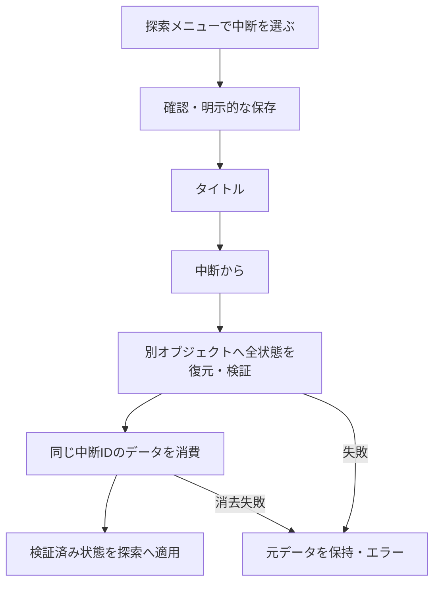

# ALPHA UX PHASE 01 完了報告

実施日：2026-10-28。

## 1. 変更ファイル一覧

製品コード：

- `rpg/suspend.py`（追加）：専用の中断形式、探索状態の復元・検証、ネイティブ/ブラウザの保存境界。
- `rpg/dungeon_app.py`：探索メニュー、確認、処理中、タイトル「中断から」、復元と入力解放。
- `rpg/models.py`：Characterに最後に使用したskill_id/位置と補正メソッド。
- `rpg/app.py`：SKILLを開く位置、空リストの安全処理。
- `rpg/battle.py`：実使用時のカーソル記憶、ボスへのSLEEP付与だけを拒否。
- `tools/web_suspend_store.js`（追加）：IndexedDBの非同期読み書き・比較消去・タイムアウト。
- `tools/build_web.py`：上記JSをWeb本体の起動前に同梱。
- `dist/game.html`：更新したゲーム本体。
- `dist/index.html`：ダンジョンメニューの説明に「中断」を1行追加。起動スクリプトは変更なし。
- `README.md`：利用方法、保存先、確認範囲。

検証：

- `tests/test_alpha_ux01.py`、`tests/fixtures/alpha_ux01_before.json`、`tests/balance_preservation.py`。
- 過去フェーズの保護テストを現在の変更範囲へ対応：`test_audio_pass.py`、`test_audio_pass02.py`、`test_audio_pass03.py`、`test_enemy_roster.py`、`test_legend_skill_presentation.py`、`test_omen_music.py`、`test_player_skill_roster.py`、`test_rare_skill_presentation.py`、`test_title_logo.py`（すべて`tests/`内）。
- `tools/snapshot_alpha_ux_methods.py`、`tools/verify_browser_suspend.py`、`tools/verify_suspend_timeout.py`。
- 本報告、`alpha_ux01_all_tests.txt`、`alpha_ux01_browser_running.json`、`alpha_ux01_browser_unavailable.json`、`alpha_ux01_packages.json`（`verification/`内）、画面キャプチャ`verification/screenshots/ux01_*.png`。

配布ZIPは項目18参照。既存のプレイヤーセーブには触れていません。

## 2. 中断セーブの保存形式・保存先

UTF-8のJSON、`suspend_version: 1`、毎回異なる`suspend_id`を使用。既存の通常SaveData v1を`game`に入れ、中断専用の探索・一時状態・乱数・UI情報を追加しています。pickleは使用しません。

| 環境 | 中断データ |
|---|---|
| PCネイティブ / GKD Pixel 2 | アプリ作業フォルダ内の`save/suspend.json` |
| Web | IndexedDB DB=`skill_seekers_suspend_v1`、store=`checkpoint`、key=`current` |

ネイティブは既存FileSaveBackendの一時ファイル→flush/fsync→置換を利用。再開時の消費中は`save/suspend.consuming.json`へ原子的に移動し、消去前の異常終了なら未消費ファイルとして回収できます。消去失敗時は元へ戻すか、その回収可能なファイルを保持します。

## 3. 保存対象の状態一覧

- 全4人：名前・成長型・能力・現在/最大HP・画像座標・スキル順序と6枠・Uses・MASTEREDコピー・履歴。
- 継続状態：Cooldown、成長ポイント、使用技/カテゴリ記録、バフ/デバフ、毒などの状態異常と残り回数、耐性、防御/反撃/バーサーク状態、最後に使用したskill_idと位置。
- 全体：DISCOVERED、MASTERED、ITEM、確定/未確定TRZ、戦闘開始/勝敗回数、結果履歴、既存のデバッグ/探索フラグ。
- 探索：階層・座標・向き・歩数・安全歩数、開封済み宝箱、未開封でも抽選済みの宝箱報酬、スイッチ、直近の宝箱処理記録、使用済み泉。
- QUEST：種別/Lv/対象階/報酬/フレーバーID、実際に配置された全地点と調査済み地点、進捗/完了、討伐対象と元階、達成記録・履歴・直前のフレーバー。
- 進行：ボス撃破/エリア解放、守護者撃破、デーモン撃破、アムリタ、最終章のフラグ、既読の石碑、初回拠点説明フラグ。
- 乱数：戦闘/成長/宝箱/配置に使うSession RNGと、独立したフレーバーRNGを両方保存。復元で抽選し直しません。
- 表示：向き、探索メッセージ、直前の噂。音声の再生位置や古い演出待ちは保存せず、復帰した階層の曲を選択します。

マップは通常プレイでは固定のTilemapで、再生成型ではありません。原本のTilemapをハッシュで識別し、ランタイムの変更は差分として保存します。DEBUGのレア宝箱配置も含め、元の`.pyxres`を書き換えずに差分を復元します。罠は元のマップ/歩数/開封記録、石碑は既読フラグで再現します。

## 4. 中断可能／不可能な場面

探索中のB/XメニューからのみUIを開けます。確認は「はい / いいえ」で初期選択は「いいえ」。

戦闘、突入演出、結果、ひらめき入替、イベント文章、フロア移動のイベント表示、守護者連戦の途中、最終イベントの途中、未処理の再習得/QUEST受注/帰還報酬など、不整合につながる状態では保存を拒否します。

保存成功後はWeb/ネイティブともタイトルへ戻ります。ネイティブはそこから既存のQ/SELECTで安全に終了できます。保存に失敗した場合は確認画面に留まり、元の探索とデータを保持します。

## 5. タイトル画面の変更内容

通常は従来の「はじめから / つづきから」。中断データがある場合だけ「中断から」を追加します。新規開始と通常LOADの機能は変更していません。

128×32ロゴは同じImage Bank 1・(0,192)を画面(16,23)へ等倍描画。3項目時はy=65/79/93に中央配置し、ロゴ・区切り・フッターと重ならないことを実描画で確認しました。中断なしの2項目は従来の配置を維持。TITLE BGMも同じです。

## 6. 中断データを一度だけ使用する仕組み

保存データを読み、元のプレイ状態を変えずに別のSession/Dungeon/Explorationを復元して検証します。その後に、読み込んだのと同じデータを保存領域から消費。成功した場合だけ新しい状態を有効化します。

WebはIndexedDBのreadwriteトランザクション内で「現在のデータと読んだデータの比較→削除」を行います。同時に2タブが再開しても成功は一方だけです。新しい中断には別のUUIDを付けるので、同じ地点を保存し直した場合でも古い読み手が新しい中断を取り違えて消費できません。

消去の失敗/abortや不正データでは、状態を有効化せずデータを保持します。ネイティブでも消費に成功する呼び出しは一つだけです。成功後に同じデータから2回目は再開できません。

## 7. 通常セーブとの分離方法

通常セーブの`save/save.json`とWeb localStorageの`skill_seekers_save_v1`はそのままです。中断は別ファイル/別DBへ保存し、通常セーブのファイル/キーに対して保存・消去しません。Webのテストでは、中断・再読み込み・復元・失敗の前後で通常セーブのJSON文字列が完全一致しました。

## 8. 旧セーブ互換性

`rpg/save.py`はファイル全体が変更前と一致し、通常の`save_version=1`を維持しています。従来の通常セーブを反復LOADし、保存されていたTRZをそのまま使い、初期3 TRZを加算しないことも回帰確認済みです。新しいカーソルフィールドは古い通常セーブでは初期値になります。

## 9. Webとネイティブの違い

ネイティブは小さなJSONファイルの原子的な書き込み/消費、Webは非同期IndexedDBトランザクション。Webの進行ループはI/O完了の小さなjobを確認するだけで、無限whileや同期的な音声待ちはありません。応答のないWeb保存処理は10秒のタイムアウトで安全に失敗させます。

タイムアウト時は進行中のトランザクションをabortします。既にcommitが完了して完了通知を待っている場合は、その通知を優先し、「消費済みなのに失敗」と誤判定しないようにしています。保存領域の無応答・進行中のabort・期限直前のcommit・期限後の遅延応答の4ケースも、期限を短縮したブラウザテストで成功しました（`verification/alpha_ux01_storage_timeout.json`）。

どちらも、自動・定期・visibilitychange・アプリ切替での保存は追加していません。タイトルでの存在確認は読み取りだけです。

## 10. カーソル記憶の実装方法

Characterに`last_skill_id`と`last_skill_index`を追加。Battleが技の実行を検証し、実際にUsesを消費した直後に記憶します。単にメニューを動かしたり、対象選択をキャンセルしたり、実行前の予約を取り消しただけでは更新しません。4人は独立したフィールドを持ちます。

## 11. スキル消滅時のカーソル補正

記憶したIDがあれば、現在のリスト内のそのIDへ移動。消滅/入替でなくなった場合は元の位置を0～現在の末尾へ補正します。使い切って消える技も、消滅前にID/位置を記憶します。空リストも安全に処理します。並び順、効果、Uses、Cooldownは変更していません。

## 12. SLEEP無効化対象のボスID一覧

| 対象 | 現在のID | データ上の名前 |
|---|---|---|
| B5ボス | guardian | 迷宮の守護者 |
| B10ボス | skill_keeper | 技の番人 |
| B15守護者1 | sentinel_armor | 重装の守護者 |
| B15守護者2 | sentinel_speed | 高速の守護者 |
| B15守護者3 | sentinel_mind | 魔導の守護者 |
| DEMON | depth_lord | デーモン |
| LORD OF ELYSION | lord_of_elysion | ロードオブエリシオン |

既存のボス戦分類`Battle.boss`と敵型を使用し、`Battle.apply_status()`でSLEEPだけを拒否。「睡眠は無効。」のメッセージを出します。技名で例外を作らないため、現在/将来のプレイヤーSLEEP付与に共通です。

## 13. 通常敵のSLEEPが変更されていない確認

`rpg/statuses.py`と`data/statuses.json`は変更なし。通常敵には従来の成功率/持続がそのまま適用されます。ボスであっても味方へのSLEEPは有効。POISON/PARALYZE/CONFUSIONも従来どおりです。

7ボス×sleep_spell/nightmare/time_stopの21組を検査。NightmareはSLEEPなしの同じ技とダメージを比較し完全一致。Uses消費も従来どおりです。

## 14. 自動テスト総数・成功数

**612/612成功**（173.946秒）。新規23テストと既存589テストです。結果：`verification/alpha_ux01_all_tests.txt`。

これとは別に、最終Web配布物でPC/タッチ×通常音声/音声復帰失敗の4構成、およびJavaScript保存処理の期限競合4ケースが成功しています。

最初の全体実行で10件の旧フェーズのファイル不変チェックが失敗しました。今回許可されたUI/カーソル/睡眠のコード差分と、ユーザー編集済みPUB文章を旧ハッシュへ戻そうとするチェックが原因です。変更前のGit HEADと作業開始時のファイルSHA一致を確認したうえで、今回の許可メソッドだけを除外する現在の保護テストへ対応しました。過去のゲーム挙動のテストは残し、すべて再実行して成功しています。

全データ、画像/マップ/パレット、BGM/SE、通常SaveData、Audio Manager、RARE/LEGEND演出、および許可メソッド以外のソースが変更前と一致します。PUBのユーザー編集もそのまま保護しています。

## 15. PCブラウザ確認結果

Edge Chromium/Pyodideの一時プロファイルで、実際のZ/Xと矢印キーにより中断確認→タイトル→ブラウザ全体再読み込み→「中断から」→探索復帰を確認。B7の全状態、確定17/未確定13 TRZ、毒残り3、Uses、実際のQUEST地点を保存前と比較し完全一致。通常セーブは文字列単位で不変です。

破損データ、書き込み例外、IndexedDBのdelete例外とトランザクションabortでもデータを保護し、エラー後も操作可能。複数タブからの同時消費も検証しています。通常音声/強制suspendしてresumeも失敗させた音声停止状態の両方で確認しました。

## 16. タッチ操作確認結果

Pixel 7のタッチエミュレーションで、HTML D-PAD/A/Bに実タッチイベントを送り、PCと同じ一連の中断・再読み込み・復帰、スキルカーソル、エラー処理を確認。キーボードなしで操作できます。確認・タイトル・復帰後の画面も目視確認済み。実端末確認とは区別しています。

ブラウザ結果：`alpha_ux01_browser_running.json` / `alpha_ux01_browser_unavailable.json`。JavaScriptのpageerrorなし。

## 17. GKD Pixel 2向け安全性確認

通常/診断ZIPの全PythonをPython 3.11構文として解析して成功。ネイティブの`pyxel.playm()`回避はそのままで、BGMはチャンネル別`pyxel.play()`を使用。既存のSELECT/Q終了と診断ランチャー、Watchdogを変更していません。

ファイルバックエンドは一時フォルダで実ファイルの書き込み、復元、消去、失敗時のロールバック、消費前クラッシュを模した回収を確認。GKD用ランチャーは従来どおりゲームフォルダへcdするので、既存の`save/`を継続利用できます。実機のSDカード/OSでの最終確認は未実施です。

## 18. 更新した配布物

- Web：`dist/game.html`、説明を追記した`dist/index.html`。
- GKD通常：`verification/packages/skill_seekers_gkd.zip`（65エントリ）。
- 診断版：`verification/packages/skill_seekers_gkd_diagnostic.zip`（68エントリ）。

全配布物の共通64ファイルが作業ツリーと一致。62技、RARE20/LEGEND8、SAVE非同梱、診断設定維持を確認済み。`alpha_ux01_packages.json`参照。更新時はゲームファイルを上書き/結合し、既存の`save/`を削除しないでください。

## 19. 実機未確認事項

iOS Safari/Androidスマートフォン実機、LINE内ブラウザでの保持、実際の画面ロック/OSのタスク終了、GKD Pixel 2のplumOS/SDカード上での中断復帰は未確認です。ブラウザの音声停止は強制suspendと復帰失敗の模擬であり、実画面ロック確認済みとはしません。

## 20. 既知の問題・設計上の制約

- 保存領域の削除/ブラウザによる消去や別ブラウザへの移動までは保護できません。クラウド、移行、エクスポート/インポートは追加していません。
- 一度きりの再開が確定してデータが消費された後にOS/ブラウザが終了した場合、同じ中断へ戻ることはできません。保存領域の消費とRAM上のプレイ継続を、OSをまたいで一つの原子的処理にはできません。通常セーブは残ります。
- マップの版が更新されて一致しない中断は、安全のためデータを残して拒否します。旧通常セーブの互換性は維持しています。
- 現在の検証で判明したゲームの進行不能・データ増殖・通常セーブ破壊はありません。GitHubへのpushは行っていません。

## 必須53ケースの対応

| No. | 確認内容 | 結果・根拠 |
|---:|---|---|
| 1～3 | B1/B7/B13で中断 | native roundtripの3階層subtest成功 |
| 4～7 | 階層/座標、HP/Uses、ITEM/確定・未確定TRZ | 中断前後の全JSON一致、Web再読み込みでも一致 |
| 8 | 開封済み宝箱再出現なし | opened/chest_loot復元と再調査で報酬増加なし |
| 9 | 探索中POISON | 残り3を保持、次戦にも引継ぎ |
| 10 | QUEST進捗 | 実配置地点・調査済み地点・進捗を完全一致 |
| 11 | ボス/ストーリー | アムリタ取得・既読石碑を含むroundtrip成功 |
| 12～14 | タイトル再開・消去・2回目不可 | UI/リロード/消費APIで成功、別タブも一方のみ |
| 15～16 | 戦闘/閃き入替中は不可 | 状態マトリクスと未処理フラグの保存拒否 |
| 17 | 破損データ | 未適用・未消去、エラー表示 |
| 18 | 保存失敗 | タイトルへ移らず元の探索を保持 |
| 19～20 | 通常セーブ分離・旧互換 | bytes不変・SaveData v1のLOAD/金額維持 |
| 21 | TRZ/ITEM/SKILL増殖防止 | 全状態上書き復元、1回消費、同時消費と新IDの取り違え拒否 |
| 22 | 復帰後の階層BGM | B7でbgm_area2 |
| 23 | 復帰後の戦闘/階段/帰還 | native実進行とWeb実入力で成功 |
| 24～25 | 使用技へ/4人独立 | skill_idの実使用記録と別々の位置を確認 |
| 26～27 | 消滅/入替 | Uses0・削除・新技追加後の範囲補正を確認 |
| 28 | CANCEL | メニュー/対象選択/予約取消のいずれも使用履歴を変更しない |
| 29 | 中断後のカーソル | Web再読み込み後もfireへ、native全状態一致 |
| 30 | 効果/消費不変 | 新規比較と既存スキルテスト成功、skills.json不変 |
| 31～37 | 全7ボスSLEEP無効 | 各ボス×3技の21組が成功 |
| 38～40 | sleep_spell/nightmare/time_stop | 無効、Nightmareのダメージ比較一致、Uses従来どおり |
| 41～43 | 通常SLEEP/他状態/敵から味方へのSLEEP | 付与成功・従来期間と既存状態異常テスト成功 |
| 44～45 | Skill62/RARE/LEGEND | データ/演出ファイル不変・既存テスト成功 |
| 46～47 | B15守護者/DEMON二回行動 | 既存終盤/敵行動回帰テスト成功 |
| 48～49 | アムリタ/BGM/Final Retry | 全体テストと同梱Web版の終盤検証成功 |
| 50 | GKD playm回避 | 音声ソース不変・native APIテスト・3.11構文成功、実機未確認 |
| 51 | Audio停止/再生失敗 | native音声回帰、Web強制suspend/復帰失敗でも中断再開と戦闘へ進行 |
| 52 | PCブラウザ | Edge ChromiumでZ/X実入力成功 |
| 53 | スマホタッチ | D-PAD/A/Bのエミュレーション成功、物理端末未確認 |
